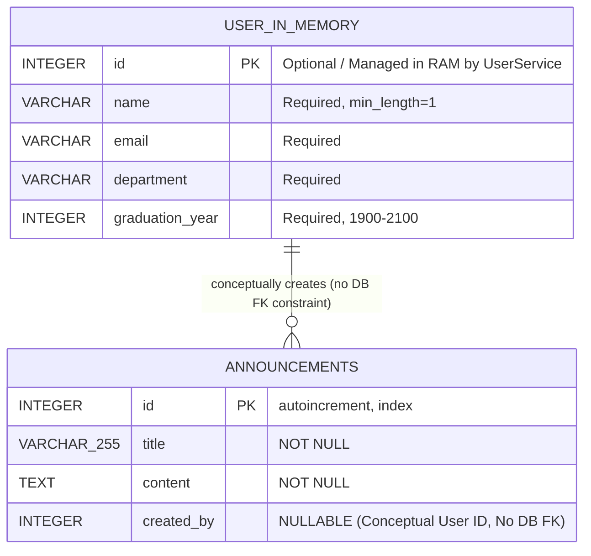

# Data Design Documentation (`add.md`)

## Alumni Management & Tracking System (İstanbul Üniversitesi Mezun Takip Sistemi)

> **Document Version:** 1.0.0  
> **Target System:** FastAPI, SQLAlchemy 2.0+, PostgreSQL 16, Pydantic v2  
> **Status:** Current Production & Development Implementation  
> **Reference File:** `add.md` (Project Root)

---

## 1. Executive Summary & Architectural Overview

The **Alumni Management & Tracking System** utilizes a modern **Layered MVC Architecture** (Routes ➔ Controllers ➔ Services ➔ Persistence / View).

As part of the system's progressive architectural roadmap, the data persistence layer is currently in a **hybrid transitional state**:

1. **Database-Backed Persistent Entities (PostgreSQL via SQLAlchemy):**  
   The **Announcements** module is fully integrated with PostgreSQL 16 using SQLAlchemy ORM. All announcements are persisted in the database and survive container restarts, system reboots, and `docker compose down` cycles (tested and verified via the "Forgetting Test").
2. **In-Memory Application Entities (Pydantic v2 in RAM):**  
   The **User (Alumni)** module currently operates using an in-memory data store (`UserService._users: Dict[int, User]`). There is **no database table** or SQLAlchemy ORM model for users in PostgreSQL at this stage.
3. **Data Transfer Objects & Validation Schemas (Pydantic v2):**  
   Strict request and response schemas govern API endpoints under `app/schemas/`, ensuring serialization, input validation, and OpenAPI documentation integrity.

> [!IMPORTANT]
> **No Imaginary Database Tables:**  
> In accordance with the project's actual implementation, only the `announcements` table exists in PostgreSQL. There is **no `users` table** in the relational database, and consequently, there is **no database-level foreign key constraint** between announcements and users.

---

## 2. Database Configuration & Persistence Infrastructure

### 2.1. Relational Database Management System (RDBMS)
- **Engine:** PostgreSQL 16 Alpine (`postgres:16-alpine`)
- **Container Service:** `alumni_db` running on network alias `db:5432`
- **Database Name:** `alumni_db`
- **Default User:** `alumni_user`
- **Persistence Mechanism:** Named Docker volume `postgres_data` mounted to `/var/lib/postgresql/data` ensures data durability across container teardown (`docker compose down`) and recreations (`docker compose up -d`).

### 2.2. SQLAlchemy Configuration (`app/core/database.py`)
- **ORM / Driver:** SQLAlchemy 2.0+ with standard synchronous dialect (`postgresql://...`).
- **Base Class:** `Base = declarative_base()` from `sqlalchemy.orm`.
- **Engine Initialization:** Lazy initialization in `get_engine()` with connection pre-ping (`pool_pre_ping=True`) for automatic stale connection recovery.
- **Session Management:**
  - `get_db_session()`: Context manager providing transactional scopes (`commit()`, automatic `rollback()` on exceptions, and guaranteed `close()`).
  - `get_db()`: Generator dependency for FastAPI route lifecycles.
- **Table Initialization:** `init_db()` invokes `Base.metadata.create_all(bind=eng)` upon startup or first service invocation.

### 2.3. Automated Testing Fallback Strategy
- When running in test mode (`APP_ENV=test`, `TESTING=true`, or `unittest` detected in `sys.modules`), `settings.get_database_url()` automatically resolves to an isolated in-memory SQLite database (`sqlite:///:memory:` with `StaticPool`).
- This guarantees test suite isolation and ensures that automated tests do not overwrite or wipe persistent PostgreSQL production data.

---

## 3. Entity Specifications (Actual Current State)

### 3.1. Database-Backed Model: `AnnouncementDB` (`announcements` Table)

Defined in [`app/models/announcement.py`](app/models/announcement.py) and mapped via SQLAlchemy ORM.

- **Class Name:** `AnnouncementDB`
- **Base:** `app.core.database.Base`
- **Table Name:** `announcements`
- **Persistence Strategy:** Persistent PostgreSQL relational table with autoincrement sequence (`announcements_id_seq`).

#### Field Details & Data Types

| Column Name | SQL Data Type | Python / SQLAlchemy Type | Primary Key | Nullable | Indexed | Constraints & Behaviors | Description |
| :--- | :--- | :--- | :---: | :---: | :---: | :--- | :--- |
| `id` | `INTEGER` | `Integer` | **YES** | NO | **YES** | `autoincrement=True` | Unique announcement identifier (Surrogate Key). |
| `title` | `VARCHAR(255)` | `String(255)` | NO | NO | NO | Max length 255 chars, required. | Title / subject of the announcement. |
| `content` | `TEXT` | `Text` | NO | NO | NO | Variable length, required. | Full body text of the announcement. |
| `created_by` | `INTEGER` | `Integer` | NO | **YES** | NO | Optional (`nullable=True`). | Conceptual author user ID (**No DB foreign key constraint**). |

#### Constraints & Relationship Notes
- **Primary Key:** `id` is the primary key and is indexed for rapid lookups (`filter(AnnouncementDB.id == announcement_id)`).
- **Foreign Keys:** **NONE**.  
  While `created_by` semantically holds the integer ID of the creating user, **no foreign key constraint exists** in PostgreSQL. This is intentional because user entities currently reside in memory and do not have a relational table in the database.
- **Cascade Rules:** N/A (no relational foreign key defined).

---

### 3.2. In-Memory / Pydantic Model: `User`

Defined in [`app/models/user.py`](app/models/user.py).

- **Class Name:** `User`
- **Base:** `pydantic.BaseModel`
- **Table Name:** *None* (No database table exists).
- **Persistence Strategy:** Purely in-memory storage within `UserService._users: Dict[int, User]`.
- **Lifecycle:** Volatile. State is stored in Python heap memory and is reset when the application process terminates or restarts.

#### Field Details & Data Types

| Field Name | Python Data Type | Pydantic Field Constraints | Default Value | Description |
| :--- | :--- | :--- | :--- | :--- |
| `id` | `Optional[int]` | Optional integer identifier. | `None` | Unique user ID, assigned sequentially by `UserService._next_id`. |
| `name` | `str` | Minimum length 1 character (`min_length=1`). | *Required* | Full name of the alumni or user. |
| `email` | `str` | Standard string representation of email. | *Required* | Email address of the user. |
| `department` | `str` | Non-empty string. | *Required* | Department graduated from or enrolled in. |
| `graduation_year` | `int` | Integer bounded by `ge=1900, le=2100`. | *Required* | Valid graduation year. |

---

### 3.3. Domain & Validation Model: `Announcement` (Pydantic)

Defined in [`app/models/announcement.py`](app/models/announcement.py).

- **Class Name:** `Announcement`
- **Base:** `pydantic.BaseModel`
- **Configuration:** `model_config = ConfigDict(from_attributes=True)` enables seamless conversion between SQLAlchemy ORM records and Pydantic models.
- **Role:** Serves as the validation contract and data transfer boundary between the database layer and web/API controllers.

#### Field Details & Data Types

| Field Name | Python Data Type | Pydantic Field Constraints | Default Value | Description |
| :--- | :--- | :--- | :--- | :--- |
| `id` | `Optional[int]` | Optional integer identifier. | `None` | Unique announcement ID. |
| `title` | `str` | `min_length=1` | *Required* | Announcement title / subject. |
| `content` | `str` | `min_length=1` | *Required* | Announcement body content. |
| `created_by` | `Optional[int]` | Optional integer ID. | `None` | User ID of the creator. |

---

## 4. Entity-Relationship (ER) Diagram

The following Mermaid ER diagram illustrates the **actual current data design**.

It explicitly reflects that:
1. `announcements` is a persistent physical table in PostgreSQL.
2. `User` is an in-memory application model.
3. The relationship between `User` and `announcements` is **conceptual only** (`created_by` stores user IDs, but no relational database foreign key constraint is enforced).



---

## 5. Persistence Strategy Comparison Matrix

| Aspect | `AnnouncementDB` (`announcements`) | `User` (Alumni) | API Schemas (`app/schemas/`) |
| :--- | :--- | :--- | :--- |
| **Model Type** | SQLAlchemy ORM Model (`Base`) | Pydantic v2 `BaseModel` | Pydantic v2 `BaseModel` |
| **Storage Medium** | PostgreSQL 16 Relational DB | In-Memory (`Dict[int, User]`) | Ephemeral (HTTP request/response) |
| **Physical Table Name** | `announcements` | *None (No DB Table)* | *None (No DB Table)* |
| **Survives `docker compose down`?** | **YES** (Stored in `postgres_data`) | **NO** (Cleared on restart) | N/A |
| **Survives Process Restart?** | **YES** (Persistent in PostgreSQL) | **NO** (RAM only) | N/A |
| **Primary Key / ID Generation** | PostgreSQL `SERIAL` / Sequence | `UserService._next_id` incrementer | Optional ID fields in payloads |
| **Foreign Key Constraints** | None (DB-level FK not defined) | None | None |
| **Active Service** | `AnnouncementService` | `UserService` | `UserController` / `Api*Controller` |
| **Transactions & Rollback** | Yes (via `get_db_session()`) | No (Direct dict mutation) | No (Validation only) |

---

## 6. API Schemas & Data Transfer Objects (DTOs)

The system defines decoupled request/response schemas in [`app/schemas/`](app/schemas/) to prevent internal model exposure and validate client inputs:

### 6.1. Announcement Schemas (`app/schemas/announcement_schemas.py`)
- `AnnouncementCreateRequest`: Validates `title` (min length 1), `content` (min length 1), `created_by` (optional int).
- `AnnouncementUpdateRequest`: Full update schema (PUT).
- `AnnouncementPatchRequest`: Partial update schema (PATCH) where all fields are optional.
- `AnnouncementResponseData`: Outgoing representation with `id`, `title`, `content`, `created_by`.
- `AnnouncementApiResponse`: Envelope schema `{"status": str, "message": Optional[str], "data": Optional[...]}`.
- `AnnouncementListApiResponse`: Collection envelope `{"status": str, "data": List[...], "count": int}`.
- `AnnouncementDeleteApiResponse`: Deletion response `{"status": str, "message": str}`.

### 6.2. User Schemas (`app/schemas/user_schemas.py`)
- `UserCreateRequest`: Validates `name`, `email`, `department`, `graduation_year`.
- `UserUpdateRequest`: Full update schema for PUT.
- `UserPatchRequest`: Partial update schema for PATCH.
- `UserResponseData`: Outgoing serialized user model.
- `UserApiResponse`, `UserListApiResponse`, `UserDeleteApiResponse`: Standard envelope schemas.

---

## 7. Future Schema Evolution & Roadmap

When the system advances to full database migration for users and related modules:

1. **`users` Table:**  
   Implement a `UserDB(Base)` SQLAlchemy model with table `users` (`id`, `name`, `email`, `department`, `graduation_year`, `created_at`).
2. **Foreign Key Formalization:**  
   Add a formal database foreign key on `announcements.created_by`:
   ```python
   # Future enhancement:
   created_by = Column(Integer, ForeignKey("users.id", ondelete="SET NULL"), nullable=True)
   ```
3. **Relational Relationships:**  
   Configure SQLAlchemy ORM relationships:
   - `UserDB.announcements = relationship("AnnouncementDB", back_populates="author")`
   - `AnnouncementDB.author = relationship("UserDB", back_populates="announcements")`
4. **Database Migrations:**  
   Introduce Alembic to manage database schema versioning and schema migrations.
