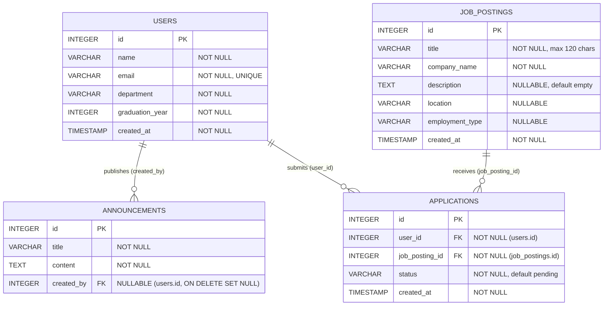

# Data Design Documentation (`add.md`)

## Alumni Management & Tracking System (İstanbul Üniversitesi Mezun Takip Sistemi)

> **Document Version:** 2.0.0  
> **Target System:** FastAPI, SQLAlchemy 2.0+, PostgreSQL 16, Pydantic v2  
> **Status:** Current Production & Development Implementation  
> **Reference File:** `add.md` (Project Root)

---

## 1. Executive Summary & Architectural Overview

The **Alumni Management & Tracking System** utilizes a modern **Layered MVC Architecture** (Routes ➔ Controllers ➔ Services ➔ Persistence / View).

All core domains are fully integrated with PostgreSQL 16 using SQLAlchemy ORM and tracked by Alembic migrations:

1. **User (Alumni) Domain:**  
   Persisted in PostgreSQL table `users` (`UserDB`). Each alumnus has a unique email, department, graduation year, and relationships with announcements and job applications.
2. **Announcements Domain:**  
   Persisted in PostgreSQL table `announcements` (`AnnouncementDB`). Includes a relational foreign key to `users.id` (`ON DELETE SET NULL`).
3. **Job Postings Domain:**  
   Persisted in PostgreSQL table `job_postings` (`JobPostingDB`). Governed by strict Pydantic v2 validation:
   - `title`: Required, maximum 120 characters (`min_length=1, max_length=120`).
   - `company_name`: Required (`min_length=1`).
   - `location` / `city`: Optional (automatically resolves `city` alias to `location`).
   - `description`: Optional (defaults to `""` in ORM to ensure constraint safety).
   - `employment_type`: Optional.
4. **Job Applications Domain:**  
   Persisted in PostgreSQL table `applications` (`ApplicationDB`). Relational link joining `users.id` and `job_postings.id` with application statuses (`pending`, `accepted`, `rejected`).
5. **Observability, Middleware & Safe Error Handling:**  
   - **HTTP Request Logging Middleware:** Logs UTC timestamp, method, path, response status, and duration in milliseconds.
   - **Custom 404 Handling:** Automatically routes web browser requests to a branded HTML 404 page, and API requests (`/api/*` or JSON clients) to a structured JSON 404 response.
   - **Safe Global 5xx Exception Handling:** Catches unexpected server errors, writes full stack trace details to `logs/error.log`, and returns sanitized 500 responses without leaking internal stack frames or credentials.

---

## 2. Database Configuration & Persistence Infrastructure

### 2.1. Relational Database Management System (RDBMS)
- **Engine:** PostgreSQL 16 Alpine (`postgres:16-alpine`)
- **Container Service:** `alumni_db` running on network alias `db:5432`
- **Database Name:** `alumni_db`
- **Default User:** `alumni_user`
- **Persistence Mechanism:** Named Docker volume `postgres_data` mounted to `/var/lib/postgresql/data` ensures data durability across container teardown (`docker compose down`) and recreations (`docker compose up -d`).

### 2.2. SQLAlchemy Configuration (`app/core/database.py`)
- **ORM / Driver:** SQLAlchemy 2.0+ with standard synchronous dialect (`postgresql://...`).
- **Base Class:** `Base = declarative_base()` from `sqlalchemy.orm`.
- **Engine Initialization:** Lazy initialization in `get_engine()` with connection pre-ping (`pool_pre_ping=True`) for automatic stale connection recovery.
- **Session Management:**
  - `get_db_session()`: Context manager providing transactional scopes (`commit()`, automatic `rollback()` on exceptions, and guaranteed `close()`).
  - `get_db()`: Generator dependency for FastAPI route lifecycles.
- **Table Initialization:** `init_db()` invokes `Base.metadata.create_all(bind=eng)` upon startup.

### 2.3. Automated Testing Fallback Strategy
- When running in test mode (`APP_ENV=test`, `TESTING=true`, or `unittest` detected in `sys.modules`), `settings.get_database_url()` automatically resolves to an isolated in-memory SQLite database (`sqlite:///:memory:` with `StaticPool`).
- This guarantees test suite isolation and ensures that automated tests do not overwrite or wipe persistent PostgreSQL production data.

---

## 3. Entity Specifications

### 3.1. `UserDB` (`users` Table)
Defined in [`app/models/user_db.py`](app/models/user_db.py).

| Column Name | SQL Data Type | Primary Key | Nullable | Indexed | Constraints & Behaviors | Description |
| :--- | :--- | :---: | :---: | :---: | :--- | :--- |
| `id` | `INTEGER` | **YES** | NO | **YES** | `autoincrement=True` | Unique alumnus identifier |
| `name` | `VARCHAR(255)` | NO | NO | NO | Required, min length 1 | Full name of the alumnus |
| `email` | `VARCHAR(255)` | NO | NO | **YES** | `unique=True` | Unique email address |
| `department` | `VARCHAR(255)` | NO | NO | NO | Required | Graduated department |
| `graduation_year` | `INTEGER` | NO | NO | NO | Required, 1900-2100 | Year of graduation |
| `created_at` | `TIMESTAMP` | NO | NO | NO | `default=datetime.utcnow` | Creation timestamp |

### 3.2. `AnnouncementDB` (`announcements` Table)
Defined in [`app/models/announcement.py`](app/models/announcement.py).

| Column Name | SQL Data Type | Primary Key | Nullable | Indexed | Constraints & Behaviors | Description |
| :--- | :--- | :---: | :---: | :---: | :--- | :--- |
| `id` | `INTEGER` | **YES** | NO | **YES** | `autoincrement=True` | Unique announcement identifier |
| `title` | `VARCHAR(255)` | NO | NO | NO | Required | Announcement title / subject |
| `content` | `TEXT` | NO | NO | NO | Required | Body text |
| `created_by` | `INTEGER` | NO | **YES** | NO | FK `users.id` (`ON DELETE SET NULL`) | Author alumnus ID |

### 3.3. `JobPostingDB` (`job_postings` Table)
Defined in [`app/models/job_posting.py`](app/models/job_posting.py).

| Column Name | SQL Data Type | Primary Key | Nullable | Constraints & Behaviors | Description |
| :--- | :--- | :---: | :---: | :--- | :--- |
| `id` | `INTEGER` | **YES** | NO | `autoincrement=True` | Unique job posting identifier |
| `title` | `VARCHAR(255)` | NO | NO | Required; Pydantic max 120 chars | Job title / position |
| `company_name` | `VARCHAR(255)` | NO | NO | Required; min 1 char | Company / Organization name |
| `description` | `TEXT` | NO | **YES** | Optional (ORM default `""`) | Responsibilities & details |
| `location` | `VARCHAR(255)` | NO | **YES** | Optional | City / Location (supports `city` alias) |
| `employment_type` | `VARCHAR(50)` | NO | **YES** | Optional | Full-time, Hybrid, Internship, etc. |
| `created_at` | `TIMESTAMP` | NO | NO | `default=datetime.utcnow` | Posting timestamp |

### 3.4. `ApplicationDB` (`applications` Table)
Defined in [`app/models/application.py`](app/models/application.py).

| Column Name | SQL Data Type | Primary Key | Nullable | Constraints & Behaviors | Description |
| :--- | :--- | :---: | :---: | :--- | :--- |
| `id` | `INTEGER` | **YES** | NO | `autoincrement=True` | Unique application identifier |
| `user_id` | `INTEGER` | NO | NO | FK `users.id` | Alumnus applicant ID |
| `job_posting_id` | `INTEGER` | NO | NO | FK `job_postings.id` | Target job posting ID |
| `status` | `VARCHAR(20)` | NO | NO | `default="pending"` | Status: pending, accepted, rejected |
| `created_at` | `TIMESTAMP` | NO | NO | `default=datetime.utcnow` | Application timestamp |

---

## 4. Entity-Relationship (ER) Diagram



---

## 5. Middleware, Error Handling & Logging Architecture

### 5.1. Request Logging Middleware (`app/core/middleware.py`)
Intercepts every HTTP transaction through `RequestLoggingMiddleware`:
- **Format:** `[YYYY-MM-DD HH:MM:SS UTC] <METHOD> <PATH> - Status: <CODE> - Duration: <DURATION>ms`
- **Output:** Streamed to console at `INFO` level.

### 5.2. Safe Global 5xx Exception Handling (`app/core/exceptions.py`)
- Catches unhandled `Exception` and 5xx HTTP exceptions.
- Server-side: Logs full stack traces with `exc_info=True` into `logs/error.log`.
- Client response: Returns sanitized response (`500 Internal Server Error`) without disclosing sensitive internal paths, database details, or credentials.

### 5.3. Custom 404 Handling (`app/core/exceptions.py` & `app/templates/404.html`)
- **Browser Routes:** Renders a responsive Istanbul University branded HTML 404 page with navigation links.
- **API Routes (`/api/*` or JSON clients):** Returns a clean JSON envelope:
  ```json
  {
    "status": "error",
    "message": "Resource not found",
    "detail": "Not Found"
  }
  ```

### 5.4. Log File Management & `.gitignore`
- Runtime log files are written to `logs/error.log`.
- `.gitignore` is configured with `logs/` and `*.log` to ensure error traces and runtime logs are never committed.
