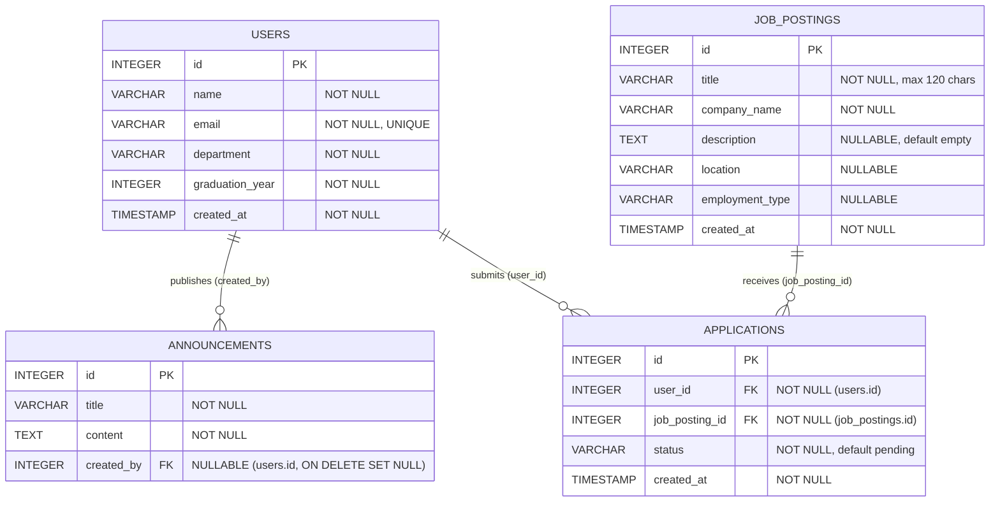

# Domain & Database Design Document (DDD)

## 1. Project Overview & Architecture

### 1.1. System Identity
The **Alumni Management and Tracking System (İstanbul Üniversitesi Mezun Takip Sistemi)** is a university portal and REST API platform designed to connect alumni, students, and academic departments. The system enables alumni tracking, community notices, employment opportunity listings, and job applications.

### 1.2. Architectural Style
The project follows a **Layered MVC (Model-View-Controller)** architecture:
- **Presentation Layer:** Server-Side Rendered (SSR) HTML via Jinja2 templates (`app/templates/`) and client assets (`app/static/`).
- **API Layer:** FastAPI routers (`app/api/`) offering OpenAPI 3.1 compliant REST endpoints.
- **Controller Layer:** Coordinates requests, payload formatting, and responses (`app/controllers/`).
- **Service Layer (Domain Logic):** Encapsulates core business rules and algorithms (`app/services/`).
- **Persistence Layer:** Dual-storage strategy featuring in-memory collections (`UserService`) alongside relational persistence via SQLAlchemy 2.0+ ORM and PostgreSQL 16 Alpine (`app/models/`, `app/core/database.py`).
- **Migration Engine:** Alembic schema versioning (`alembic/`).

---

## 2. User Domain

### 2.1. User Entity Overview
In Domain-Driven Design (DDD) terminology, the **User** represents the core domain identity of an alumnus within the university network.

The domain contains two complementary representations:
1. **Domain / Validation Entity (`User` in [`app/models/user.py`](app/models/user.py)):**
   A Pydantic v2 domain model that validates alumni attributes independently of any database backend.
2. **Relational Database Model (`UserDB` in [`app/models/user_db.py`](app/models/user_db.py)):**
   A SQLAlchemy declarative model mapping to the `users` table in PostgreSQL, enforcing database-level integrity, unique constraints, and foreign key relationships.

### 2.2. User Attributes Specification

| Attribute | Python Type | SQL Column Type | Constraints & Rules | Description |
|---|---|---|---|---|
| `id` | `Optional[int]` | `INTEGER` | Primary Key, `autoincrement=True`, Indexed | Unique numeric user identifier. |
| `name` | `str` | `VARCHAR(255)` | `nullable=False`, `min_length=1` | Full name of the alumnus. |
| `email` | `str` | `VARCHAR(255)` | `nullable=False`, `unique=True`, Valid email | Primary electronic contact address. |
| `department` | `str` | `VARCHAR(255)` | `nullable=False` | Graduated academic department or faculty. |
| `graduation_year` | `int` | `INTEGER` | `nullable=False`, `1900 <= year <= 2100` | Calendar year of university graduation. |
| `created_at` | `Optional[datetime]` | `TIMESTAMP` | `nullable=False`, Default `datetime.utcnow` | Timestamp when the user record was created. |

### 2.3. Dual Representation & Current Persistence Behavior
- **Web UI & User Service:**
  The user CRUD operations (`/users`, `/users/{id}`, `/users/{id}/edit`, `/users/{id}/delete`) and user REST API endpoints (`/api/users/*`) delegate to `UserController` and `ApiUserController`, which in turn delegate to `UserService` (`app/services/user_service.py`). Currently, `UserService` operates on an in-memory dictionary (`Dict[int, User]`).
- **PostgreSQL Relational Storage:**
  The `users` table is materialized in PostgreSQL via Alembic migration `42053b92e130` and represented by `UserDB`. It serves as the relational anchor for database foreign keys (`announcements.created_by` and `applications.user_id`).

### 2.4. User Lifecycle & Responsibilities
The User lifecycle encompasses the following stages:

```
┌─────────────────┐       Validate & Persist        ┌─────────────────┐
│  Registration   ├────────────────────────────────►│     Active      │
│  (Create User)  │                                 │     Alumnus     │
└─────────────────┘                                 └────────┬────────┘
                                                             │
                         ┌───────────────────────────────────┼───────────────────────────────────┐
                         ▼                                   ▼                                   ▼
                 ┌───────────────┐                   ┌───────────────┐                   ┌───────────────┐
                 │    Update     │                   │  Interaction  │                   │   Deletion    │
                 │ Profile Data  │                   │ (Apply / Post)│                   │ (Remove User) │
                 └───────────────┘                   └───────────────┘                   └───────────────┘
```

1. **Creation (Onboarding):**
   - Initiated via web form (`POST /users`) or REST API (`POST /api/users`).
   - Validates that `name` is non-empty, `email` is provided, `department` is specified, and `graduation_year` falls within `[1900, 2100]`.
   - Assigns a unique auto-incrementing ID.
2. **Reading & Discovery:**
   - Listed collectively (`GET /users`, `GET /api/users`) for alumni directory exploration.
   - Queried individually (`GET /users/{id}`, `GET /api/users/{id}`) for profile inspection.
3. **Profile Maintenance:**
   - Full updates via `PUT /users/{id}` or `PUT /api/users/{id}`.
   - Partial updates via `PATCH /api/users/{id}` (e.g., updating email or department without touching other attributes).
4. **Domain Interactions:**
   - **Publishing Announcements:** An alumnus can author university or community notices (`announcements.created_by`).
   - **Submitting Job Applications:** An alumnus can apply for posted job opportunities by providing their `user_id` (`applications.user_id`).
5. **Termination (Deletion):**
   - Deletion via `POST /users/{id}/delete`, `DELETE /users/{id}`, or `DELETE /api/users/{id}`.
   - Database cascading behavior:
     - Authored announcements have their `created_by` foreign key set to `NULL` (`ON DELETE SET NULL`), preserving public notices while dissociating the deleted user.
     - Job applications linked to `users.id` enforce foreign key integrity.

---

## 3. User Roles

### 3.1. Implemented Role Architecture
Inspection of the current codebase (`models/`, `core/`, `api/`, `controllers/`, and `services/`) reveals:

> [!IMPORTANT]
> **Current Implementation Status: Single-Tier Role-Free System**
> There is **no role attribute** (such as an enum or string column for `role`, `is_admin`, or `user_type`) in either `User` or `UserDB`. There are no role tables or group assignments implemented in the code or database schema.

In the current operational codebase, the system operates with two de facto functional actor types:

1. **Anonymous / Public Client (Caller):**
   Any HTTP client interacting with the application. Because authentication and authorization guards are not yet implemented, any caller possesses equal, unconstrained administrative abilities across both the Web UI and REST API.
2. **Alumnus Identity (Data Subject / Entity):**
   The record stored in the system representing an individual graduate (`User` / `UserDB`). The caller can declare or act on behalf of any alumnus by referencing their integer `id`.

### 3.2. Role Responsibilities & Operational Boundaries

| Actor | Description | Implemented Capabilities | Implemented Limitations |
|---|---|---|---|
| **Anonymous / Public Client** (Current Caller) | Any external browser or REST API consumer connecting to the platform. | - Browse and view all users, jobs, announcements, and applications.<br>- Create new users, job postings, announcements, and applications.<br>- Edit or update any user, announcement, or job posting.<br>- Delete any user, announcement, job posting, or application.<br>- Advance application statuses (`pending` ➔ `accepted`/`rejected`). | None. The system enforces no identity checks or role restrictions. |
| **Alumnus Record** (Domain Entity) | An alumni identity stored in memory and PostgreSQL. | - Serves as the applicant on job applications (`applications.user_id`).<br>- Serves as the author of community announcements (`announcements.created_by`).<br>- Displayed in public directories. | Does not hold credentials, tokens, or permissions. Cannot self-govern access rights. |

### 3.3. Role-Permission Matrix

The table below contrasts the **Actual Implemented Status** (all callers have access) with the **Target RBAC Specification** scheduled for Phase 3:

| Resource & Action | HTTP Method & Route | Actually Implemented | Target Phase 3 RBAC |
|---|---|:---:|---|
| **View Alumni Directory** | `GET /users`, `GET /api/users` | **Public** (All callers) | Public / Authenticated |
| **View Alumnus Profile** | `GET /users/{id}`, `GET /api/users/{id}` | **Public** (All callers) | Public / Authenticated |
| **Register New Alumnus** | `POST /users`, `POST /api/users` | **Public** (All callers) | Public (Self-registration) or Admin |
| **Edit Alumnus Profile** | `PUT/PATCH /users/{id}`, `/api/users/{id}` | **Public** (All callers) | **Self** (Profile Owner) or **Admin** |
| **Delete Alumnus Account** | `DELETE /users/{id}`, `/api/users/{id}` | **Public** (All callers) | **Self** or **Admin** |
| **Browse Job Postings** | `GET /jobs`, `GET /api/job-postings` | **Public** (All callers) | Public |
| **Create Job Posting** | `POST /api/job-postings` | **Public** (All callers) | **Admin** or Verified Employer/Alumnus |
| **Update / Delete Job Posting** | `PUT/PATCH/DELETE /api/job-postings/{id}` | **Public** (All callers) | **Admin** or Job Author |
| **Submit Job Application** | `POST /jobs/{id}/apply`, `POST /api/applications` | **Public** (Passes `user_id`) | **Authenticated Alumnus** (Automatic `user_id`) |
| **View All Applications** | `GET /applications`, `GET /api/applications` | **Public** (All callers) | **Admin** only |
| **View User's Applications** | `GET /api/users/{user_id}/applications` | **Public** (All callers) | **Self** or **Admin** |
| **Update Application Status** | `PATCH /api/applications/{id}` | **Public** (All callers) | **Admin** or Job Poster only |
| **Browse Announcements** | `GET /announcements`, `GET /api/announcements` | **Public** (All callers) | Public |
| **Publish Announcement** | `POST /announcements`, `POST /api/announcements` | **Public** (All callers) | **Admin** or **Academician** |
| **Edit / Delete Announcement** | `POST/DELETE /announcements/{id}/*` | **Public** (All callers) | **Author** or **Admin** |

### 3.4. Planned Roles (Phase 3 Roadmap)
As defined in the project roadmap ([`README.md`](README.md#-%EF%B8%8F-gelecek-a%C5%9Famalar-roadmap)), the upcoming Phase 3 release will formalize the following four distinct user roles:
1. **Admin (Yönetici):** Full platform moderation, user account management, job approval, announcement management, and application review.
2. **Alumnus (Mezun):** Profile maintenance, career history tracking, job application submission, and networking.
3. **Student (Öğrenci):** Internship applications, mentorship requests, and viewing public announcements.
4. **Academician (Akademisyen):** Department announcements, academic notices, and graduate recommendations.

---

## 4. Authentication (AuthN)

### 4.1. Current Implementation Status

> [!WARNING]
> **Authentication is NOT yet implemented in the codebase.**
> - There are **no login endpoints** (e.g., `/login`, `/api/auth/login`).
> - There are **no logout endpoints** or session revocation lists.
> - There are **no password hashes, salts, or credentials** stored in `User` or `UserDB`.
> - There are **no session cookies, JWT tokens, API keys, or OAuth2 workflows**.

### 4.2. Current Client-Server Interaction Model
Currently, identity is established through **declarative parameter assertion**:
- When applying for a job via the web form (`POST /jobs/{job_id}/apply`), the form contains an input field named `user_id`. The client manually types an integer (e.g., `1`).
- When applying via the REST API (`POST /api/applications`), the client supplies JSON: `{"user_id": 1, "job_posting_id": 5}`.
- When creating an announcement (`POST /announcements`), the client optionally supplies `created_by=1`.
- The server checks whether the foreign key reference exists in PostgreSQL; if not, an `IntegrityError` or HTTP 400 is raised. However, no proof of identity (password, signature, or token) is verified.

```
[ Client / Browser ] ────────── HTTP POST /jobs/3/apply ──────────► [ Server (FastAPI) ]
                     Body: { user_id: 1 } (No password / token)
                                                                     Verifies FK in DB
[ Client / Browser ] ◄────────── 201 Created / Success ───────────   Records application
```

### 4.3. Planned Authentication Architecture (Phase 3)
In Phase 3, standard token-based authentication will be introduced:
1. **Credentials Storage:** Add `hashed_password` (using `bcrypt` or `argon2`) and `role` to `UserDB`.
2. **Login Route (`POST /api/auth/token`):** Validates email and password; generates a cryptographically signed JSON Web Token (JWT).
3. **Token Transmission:** Client stores JWT and supplies it in subsequent requests via the HTTP header:
   ```http
   Authorization: Bearer <jwt_access_token>
   ```
4. **FastAPI Dependency Injection:** Reroutes will inspect `OAuth2PasswordBearer` and decode the token into a `CurrentUser` object.

---

## 5. Authorization (AuthZ)

### 5.1. Current Implementation Status

> [!WARNING]
> **Authorization and Role-Based Access Control (RBAC) are NOT yet implemented.**
> - There are **no security dependencies** (e.g., `Depends(get_current_user)`, `Depends(require_role)`).
> - All HTTP routes (GET, POST, PUT, PATCH, DELETE) across all modules are **publicly open**.
> - There is **no resource ownership enforcement** (Insecure Direct Object Reference - IDOR vulnerability by design during early development).

### 5.2. Analysis of Current Route Exposure
- **Unrestricted Data Modification:** Any caller can invoke `PATCH /api/applications/{id}` with `{"status": "accepted"}` to accept their own or any other user's job application without administrator rights.
- **Unrestricted Resource Destruction:** Any caller can invoke `DELETE /api/users/{id}` or `DELETE /api/announcements/{id}` to permanently delete any alumni record or announcement without identity or permission checks.
- **Unrestricted Directory Access:** All applications, including applicant names and IDs, are exposed to any caller on `GET /applications` and `GET /api/applications`.

### 5.3. Planned Authorization Architecture (Phase 3)
The planned authorization layer will utilize FastAPI dependencies and declarative permission guards:

```python
# Planned Architecture Example
@router.delete("/api/announcements/{id}")
def delete_announcement(
    id: int,
    current_user: User = Depends(get_current_active_user),
    db: Session = Depends(get_db)
):
    announcement = get_announcement_or_404(db, id)
    # RBAC Guard: Author or Admin
    if announcement.created_by != current_user.id and current_user.role != "admin":
        raise HTTPException(status_code=403, detail="Not authorized to delete this announcement")
    ...
```

---

## 6. Authentication vs. Authorization

To maintain architectural clarity within the Alumni Tracking System, the concepts of Authentication and Authorization are defined and contrasted below:

```
┌─────────────────────────────────────────────────────────────────────────────┐
│                             INCOMING HTTP REQUEST                           │
└──────────────────────────────────────┬──────────────────────────────────────┘
                                       │
                                       ▼
                 ┌───────────────────────────────────────────┐
                 │          AUTHENTICATION (AuthN)           │
                 │          "Who is making the request?"     │
                 └─────────────────────┬─────────────────────┘
                                       │
                         [ Valid Credentials / Token ]
                                       │
                                       ▼
                 ┌───────────────────────────────────────────┐
                 │          AUTHORIZATION (AuthZ)            │
                 │          "What is this actor permitted    │
                 │           to perform on this resource?"   │
                 └─────────────────────┬─────────────────────┘
                                       │
                         [ Permission / Role Granted ]
                                       │
                                       ▼
                 ┌───────────────────────────────────────────┐
                 │       EXECUTE CONTROLLER & SERVICE        │
                 └───────────────────────────────────────────┘
```

### 6.1. Conceptual Distinction

| Dimension | Authentication (AuthN) | Authorization (AuthZ) |
|---|---|---|
| **Fundamental Question** | *"Who are you?"* | *"What are you allowed to do?"* |
| **Primary Objective** | Proves identity via credentials (passwords, tokens, biometric data). | Enforces access policies, permissions, and roles on resources. |
| **Execution Point** | Early in the request lifecycle (authentication middleware or header extractor). | Route-level dependency or service-level guard, following successful authentication. |
| **HTTP Error Codes** | **`401 Unauthorized`** (Identity unverified, missing, or token expired). | **`403 Forbidden`** (Identity verified, but lacks necessary privileges). |
| **Current Status in Project** | **Not implemented.** Identity is asserted by sending integer IDs without passwords. | **Not implemented.** All endpoints and operations are universally accessible. |
| **Phase 3 Implementation** | JWT generation and validation via `POST /api/auth/token`. | RBAC dependencies verifying roles (`Admin`, `Alumnus`, `Student`, `Academician`). |

### 6.2. Concrete Project Scenarios

1. **Scenario A: Editing an Alumnus Profile (`PUT /api/users/42`)**
   - **AuthN:** Verifies that the bearer of the request is indeed user #42 (or an administrator) through a verified cryptographic signature on the JWT.
   - **AuthZ:** Checks whether user #42 has permission to edit profile #42 (allowed: self-modification) or whether user #15 is attempting to modify user #42 (denied: 403 Forbidden unless user #15 possesses the `Admin` role).
2. **Scenario B: Reviewing and Accepting a Job Application (`PATCH /api/applications/10`)**
   - **AuthN:** Identifies the user executing the call via their token.
   - **AuthZ:** Validates that the caller is assigned the `Admin` role or is the authorized recruiter for the corresponding job posting. Regular alumni applicants attempting this request receive `403 Forbidden`.

---

## 7. Domain Entities & Database Schemas

The system defines four relational database tables managed by SQLAlchemy ORM and Alembic migrations in PostgreSQL 16.

### 7.1. `users` Table
Relational table representing registered alumni users. Defined in [`app/models/user_db.py`](app/models/user_db.py).

| Field | Type | Constraints | Description |
|---|---|---|---|
| `id` | `INTEGER` | Primary Key, `autoincrement=True` | Unique user identifier |
| `name` | `VARCHAR(255)` | `NOT NULL` | Full name of the alumnus |
| `email` | `VARCHAR(255)` | `NOT NULL, UNIQUE` | Unique email address |
| `department` | `VARCHAR(255)` | `NOT NULL` | Graduated department |
| `graduation_year` | `INTEGER` | `NOT NULL` | Year of graduation |
| `hashed_password` | `VARCHAR(255)` | `NULLABLE` | Secure PBKDF2-HMAC-SHA256 password hash |
| `role` | `VARCHAR(50)` | `NOT NULL, default='alumnus'` | System authorization role |
| `created_at` | `TIMESTAMP` | `NOT NULL, default=datetime.utcnow` | Record creation timestamp |

### 7.2. `announcements` Table
University notices and alumni community announcements. Defined in [`app/models/announcement.py`](app/models/announcement.py).

| Field | Type | Constraints | Description |
|---|---|---|---|
| `id` | `INTEGER` | Primary Key, `autoincrement=True`, Index | Unique announcement identifier |
| `title` | `VARCHAR(255)` | `NOT NULL` | Announcement title / subject |
| `content` | `TEXT` | `NOT NULL` | Body content |
| `created_by` | `INTEGER` | `NULLABLE`, FK `users.id` (`ON DELETE SET NULL`) | Author user ID |

### 7.3. `job_postings` Table
Employment and internship opportunities for alumni. Defined in [`app/models/job_posting.py`](app/models/job_posting.py).

| Field | Type | Constraints & Validation | Description |
|---|---|---|---|
| `id` | `INTEGER` | Primary Key, `autoincrement=True` | Unique job posting identifier |
| `title` | `VARCHAR(255)` | `NOT NULL`, Schema validation: Max 120 chars | Job title / position (Required) |
| `company_name` | `VARCHAR(255)` | `NOT NULL`, Schema validation: Min 1 char | Company / Organization name (Required) |
| `description` | `TEXT` | `NULLABLE`, default `""` in ORM | Role responsibilities (Optional) |
| `location` | `VARCHAR(255)` | `NULLABLE` | City / Location (Optional, accepts `city` alias) |
| `employment_type` | `VARCHAR(50)` | `NULLABLE` | Work arrangement (Optional: Full-time, Hybrid, etc.) |
| `created_at` | `TIMESTAMP` | `NOT NULL, default=datetime.utcnow` | Posting timestamp |

### 7.4. `applications` Table
Job applications connecting alumni users to job postings. Defined in [`app/models/application.py`](app/models/application.py).

| Field | Type | Constraints | Description |
|---|---|---|---|
| `id` | `INTEGER` | Primary Key, `autoincrement=True` | Unique application identifier |
| `user_id` | `INTEGER` | `NOT NULL`, FK `users.id` | Alumnus applying for the role |
| `job_posting_id` | `INTEGER` | `NOT NULL`, FK `job_postings.id` | Target job posting |
| `status` | `VARCHAR(20)` | `NOT NULL, default='pending'` | Application state (`pending`, `accepted`, `rejected`) |
| `created_at` | `TIMESTAMP` | `NOT NULL, default=datetime.utcnow` | Submission timestamp |

---

## 8. Domain Relationships & Interaction Patterns

### 8.1. Entity-Relationship Diagram (ERD)



### 8.2. Domain Interaction Analysis

1. **User to Announcements (1 : N):**
   - An alumnus can author zero or many announcements.
   - Foreign key: `announcements.created_by` references `users.id`.
   - **Referential Integrity Action:** `ON DELETE SET NULL`. If an alumnus is removed from the database, their notices remain visible as institutional history with an unassigned author (`created_by = NULL`).
2. **User to Applications (1 : N):**
   - An alumnus can submit applications to zero or many job postings.
   - Foreign key: `applications.user_id` references `users.id`.
   - **Application Uniqueness / Rules:** An applicant must reference an existing user in PostgreSQL; attempting to submit an application with a non-existent `user_id` triggers an `IntegrityError` (handled as HTTP 400).
3. **Job Posting to Applications (1 : N):**
   - A single job posting can receive zero or many applications from different alumni.
   - Foreign key: `applications.job_posting_id` references `job_postings.id`.
4. **User to Job Postings (Indirect Interaction):**
   - Job postings are currently institutional/organizational records not directly owned by a `User` foreign key.
   - Alumni interact with job postings exclusively through the join entity `applications`.

---

## 9. Implemented Application Interfaces

The job application functionality is operational across both the Web UI and REST API:

### 9.1. Web Interface Routes ([`app/api/job_web_routes.py`](app/api/job_web_routes.py))
- `GET /jobs`: Browse available job opportunities.
- `GET /jobs/{job_id}/apply`: View specific job details and interactive application form.
- `POST /jobs/{job_id}/apply`: Submits application with applicant `user_id`; validates nonexistent users via PostgreSQL foreign key handling.
- `GET /applications`: Consolidated dashboard listing submitted applications with applicant and company details.

### 9.2. REST API Routes ([`app/api/application_routes.py`](app/api/application_routes.py) & [`app/api/application_nested_routes.py`](app/api/application_nested_routes.py))
- `GET /api/applications`: List all applications in the system.
- `POST /api/applications`: Submit new application (`user_id`, `job_posting_id`).
- `GET /api/applications/{id}`: Retrieve application details by ID.
- `PATCH /api/applications/{id}`: Update application status (`pending`, `accepted`, `rejected`).
- `DELETE /api/applications/{id}`: Delete an application.
- `GET /api/users/{user_id}/applications`: Nested route retrieving all applications submitted by a specific user.
- `GET /api/job-postings/{job_posting_id}/applications`: Nested route retrieving all applications submitted for a specific job posting.

---

## 10. Database Migrations & Schema Evolution

Database schema evolution is tracked and applied through Alembic migrations (`alembic/versions/`):

1. **`6e2d08209d01` (`create_announcements_table`):**
   Initial creation of the `announcements` table with primary key `id`, `title`, and `content`.
2. **`26154c96bb06` (`create_job_postings_table`):**
   Created the `job_postings` table with `title`, `company_name`, `description`, `location`, `employment_type`, and `created_at`.
3. **`42053b92e130` (`create_users_table_and_announcement_`):**
   Created the `users` table with `id`, `name`, `email` (unique), `department`, `graduation_year`, and `created_at`. Established foreign key link `announcements.created_by -> users.id` with `ON DELETE SET NULL`.
4. **`9aa14a4442a2` (`create_applications_table`):**
   Created the `applications` table establishing the relational link between `users` (`user_id`) and `job_postings` (`job_posting_id`), with default status `pending`.
5. **`c1f4e92a8b3d` (`add_hashed_password_and_role_to_users`):**
   Added `hashed_password` (`VARCHAR(255)`, nullable) and `role` (`VARCHAR(50)`, default `'alumnus'`) to `users` via batch alterations for secure alumni registration and safe role assignment.
